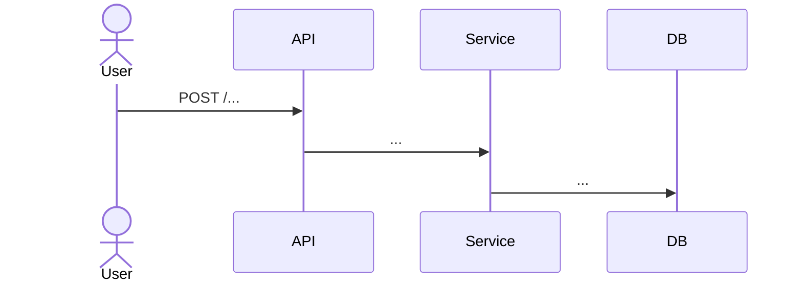

# Report Template

Fill in this structure. Drop any subsection that would only say "none" or "n/a", with one exception: always keep Findings, Verification results, and Final assessment.

---

~~~~markdown
# Feature Understanding: <PR title or branch name>

**Reviewed:** `<head branch or sha>` against `<base>` (merge base `<short sha>`, found via <how>)
**Size:** <N> commits, <files> files, +<add>/−<del>
**Requirements source:** PR description | commit messages | inferred from code

## Feature summary
<2–5 sentences in plain English: what it does, for whom, and why.>

## Architecture overview
| Module / layer | Responsibility in this PR | New or changed |
|---|---|---|
| ... | ... | ... |

<One short paragraph: does this fit the project's existing structure?>

## Execution flow
<Numbered steps from the user action or trigger to the final persisted state, with file references.
Add a Mermaid sequence or flow diagram only when there are 3+ components or branching paths.>

## Data flow
- **Received:** <inputs and their source>
- **Validated:** <where and how; note any gaps>
- **Modified:** <entities and fields>
- **Persisted:** <tables, files, caches>
- **External systems:** <APIs, queues, storage, or "none">

## Change impact
| Area | Summary |
|---|---|
| API | ... |
| Business logic | ... |
| Database | ... |
| Infrastructure | ... |
| Security | ... |
| Tests | ... |
| Configuration | ... |

## Ambiguities
- <requirement or behavior that's unclear, and the two plausible readings>

## Critical review areas
1. **<area>:** <why it deserves human eyes> (`path/file.ext:line`)
2. ...
<3–5 items. These are where the reviewer should spend their own time.>

---

# PR Review: <PR title or branch name>

## Findings

### [P1] <Short title> (Confirmed)
- **Location:** `path/to/file.ext:123` (+ other locations with the same root cause)
- **Problem:** <what's wrong>
- **When it happens:** <inputs, state, timing>
- **Consequence:** <the actual effect in production>
- **Suggested fix:** <the minimal change, in the project's idiom>

<Repeat, ordered P0 → P3. If there are no findings, write "No actionable findings.">

## Open questions
- <Speculative concern, or an ambiguity that needs the author's answer, and what would resolve it.>

## Verification results
| Check | Status | Details |
|---|---|---|
| Build | Passed / Failed / Not run | `<exact command>`, <reason if not run> |
| Tests | Passed x/y / Failed / Not run | `<exact command>`, <scope> |
| Static analysis / lint | ... | ... |
| Base freshness | fetched / local refs only | ... |

**Important unverified behavior:**
- <behavior that no executed check or test covers>

## Final assessment
**<APPROVE | REQUEST CHANGES | NEEDS INVESTIGATION>**: <2–3 sentences on why, naming the blocking findings or open questions.>
~~~~
